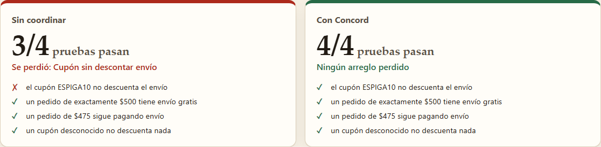

# Relevo

**Un laboratorio local para ver, con ejecuciones reales, cuándo Concord MCP evita
que dos agentes de código se pisen.**

Relevo toma un incidente pequeño y ficticio (la tienda en línea de una panadería
con dos fallos en el mismo archivo) y lo resuelve **dos veces en tu máquina**:

1. **Sin coordinar.** Dos participantes abren `src/totales.js` a la vez y cada uno
   guarda su copia. El segundo borra el arreglo del primero sin que git se queje.
   Resultado real: 3 de 4 pruebas pasan.
2. **Con Concord.** Los mismos participantes y los mismos cambios, pero cada uno
   trabaja a través de su propio proceso `concord-mcp`: reclaman el archivo,
   Concord avisa del choque, la guardia `concord check` frena al segundo, se
   escriben, trabajan por turnos, una sesión se cae y otra la retoma, y el
   trabajo pasa a revisión con evidencia. Resultado real: 4 de 4.

Al final, la página muestra 9 comprobaciones calculadas con lo que respondieron
los procesos (por ejemplo, «concord check frena antes y libera después: 1 → 0»)
y los archivos que Concord dejó en el repo (`REVIEW_PACKET.md`, `HANDOFF.md`).



### Qué es y qué no es

- **Los participantes son actores de demostración**: scripts deterministas con
  una sola tarea cada uno. **No hay IA en vivo** ni se llama a ningún modelo o
  servicio de pago. Lo que sí es real es todo lo demás: los procesos de Concord,
  sus respuestas, los commits de git y las pruebas.
- No es un clon de Concord ni un panel con datos inventados. Si Concord cambia su
  comportamiento, las comprobaciones de la página fallan y lo enseñan.
- Proyecto independiente, no afiliado a Concord AI.

### Para qué sirve

- Entender en pocos minutos qué resuelve Concord (y qué no) antes de instalarlo
  en tus agentes reales.
- Tener un **banco de pruebas reproducible** de su protocolo: si una versión
  nueva rompe los choques, los mensajes o los relevos, se nota aquí.
- Ver una forma de ejecutarlo **aislado**: sin telemetría, sin red y sin tocar tu
  configuración global ni otros repos (ver [revisión](docs/REVISION_SEGURIDAD.md)).

## Empezar (Windows)

Requisitos: Node.js 22.18 o superior, npm y git. Verificado en Windows con Node.js 22.20.0. La comprobación de navegador requiere Edge o Chrome instalado; ejecutar el laboratorio no requiere claves de API.

```powershell
git clone https://github.com/Jair0305/relevo.git
cd relevo
.\iniciar.cmd
```

`iniciar.cmd` instala las dependencias fijadas (sin scripts de instalación) la
primera vez, abre el navegador y arranca en <http://localhost:4317>. A mano:

```powershell
npm ci --ignore-scripts
npm start
```

Solo escucha en `127.0.0.1`. Pulsa **Correr el laboratorio**: tarda unos 8–10 s.
Si no quieres ejecutar nada, **Ver una corrida capturada** muestra una corrida
real guardada en `captures/corrida-referencia.json`.

## Cómo funciona

```text
navegador ──HTTP (127.0.0.1)──▶ server/http.ts ──▶ runs/executor.ts ──▶ scenario/run-scenario.ts
                                                                         │
            ┌────────────────────────────────────────────────────────────┤
            │ carril «sin coordinar»: git + node --test (sin Concord)     │
            │ carril «con Concord»:                                       │
            │   Caja ──MCP stdio──▶ concord-mcp (proceso 1) ┐             │
            │   Reparto ──MCP stdio──▶ concord-mcp (2, luego 3 tras caída)├─▶ .concord/concord.db (SQLite)
            │   Revisión ──MCP stdio──▶ concord-mcp (4)    ┘             │
            │   guardia: concord check (CLI real)                         │
            └─────────────────────────────────────────────────────────────┘
```

- Cada corrida crea dos repos git sintéticos bajo `data/runs/<id>/` copiando
  `server/scenario/fixture/`. Los actores solo pueden escribir `src/totales.js`.
- Cada actor habla con **su propio proceso** `concord-mcp` mediante el SDK oficial
  de MCP (`@modelcontextprotocol/sdk`, cliente stdio), con identidad de operador
  (`CONCORD_AGENT_ID`). Todos comparten el SQLite del repo, como varios agentes
  reales en una misma copia de trabajo.
- Las pruebas del fixture se corren con `node --test` bajo el modelo de permisos
  (solo lectura del workspace).
- Cada paso se guarda con la respuesta literal del proceso (texto y JSON
  estructurado) y la interfaz la muestra en «Ver lo que respondió Concord».

Sin build: el servidor es TypeScript ejecutado por Node (type stripping) y la
interfaz es HTML/CSS/JS sin framework, comprobada con `tsc --checkJs`.

## Uso real de Concord (probado)

Versión fijada: `@concord-ai/concord-mcp@0.19.0`. Todo lo de esta tabla se
ejecuta en cada corrida y está cubierto por `test/concord-integration.test.ts`.

| Capacidad                    | Llamada real                                                    | Lo que se comprueba                                                                 |
| ---------------------------- | --------------------------------------------------------------- | ----------------------------------------------------------------------------------- |
| Presencia y reclamo          | `start_work` con `expected_files`, `modules`, `domains`         | Registra al agente y reporta `overlaps` con `same file(s): src/totales.js`          |
| El aviso no es candado       | `start_work` del segundo actor                                  | El reclamo con choque se acepta (`ok`), con 1 choque                                |
| Guardia antes de editar      | `concord check --task T-ENVIO src/totales.js`                   | Sale con 1 mientras T-CUPON lo reclama y con 0 cuando pasa a `review_ready`         |
| Mensajes entre agentes       | `update_work` `prompt` / `reply` con `idempotency_key`          | Entrega `queued_pull`; pasa a `read` al revisar la bandeja; misma clave = mismo mensaje |
| Privacidad de la bandeja     | `inspect_work {agent_id: otro}`                                 | Devuelve `private: true` sin contenido                                              |
| Memoria de la tarea          | `update_work` `decision`, `intent`, `finding`                   | Persisten; un no-dueño solo puede dejar `finding`/`question`                        |
| Caída y recuperación         | proceso terminado a la fuerza + nuevo `inspect_work {task_id}`  | La sesión nueva recupera el plan y los mensajes                                     |
| Relevo con evidencia         | `transfer_work` `offer` / `accept`                              | Exige versión vigente; un `accept` duplicado se rechaza; historial de dueños        |
| Cierre con resultado medido  | `finish_work` `review_ready` y `complete` con `reported_outcome` + `provenance` | Genera `REVIEW_PACKET.md` y `HANDOFF.md`                             |
| Estado del workspace         | `inspect_work {}`                                               | Presencia, choques activos, tareas listas para revisión                             |

Limitaciones que la corrida deja a la vista: los choques son avisos; sin un
adaptador en vivo los mensajes esperan en cola (los actores no tienen adaptador,
a propósito); tras la caída Concord sigue viendo al agente como `live` (pasa a
inactivo a los 5 min); la identidad la pone quien lanza el proceso.

**No probado aquí:** entrega en vivo a sesiones reales de Claude Code/Codex
(requiere `concord setup` y adaptadores globales), Concord Cloud, el dashboard
TUI y el modo global.

## Pruebas

```powershell
npm run check          # tsc estricto sobre servidor, pruebas e interfaz (checkJs)
npm test               # 12 pruebas de integración: Concord real + servidor HTTP
npm run browser-check  # recorre la app en Edge/Chrome headless y guarda capturas
npm run verify         # las tres
npm run capture        # corre de verdad y guarda una repetición en captures/
```

Resultados de la última ejecución en [docs/evidencias/](docs/evidencias/):
`pruebas-integracion.txt` (ejecución inicial 11/11), `verificacion-final.txt`
(revisión final 12/12), `browser-check.json` (13/13) y las capturas.

`npm test` incluye una corrida completa vía HTTP y comprueba que el JSON guardado
no contiene rutas locales. `browser-check` usa `playwright-core` con el
navegador ya instalado (no descarga navegadores) y un perfil temporal.

## Datos y privacidad

- Todo ocurre en tu máquina. El escenario es ficticio y no usa código ni datos de
  ningún negocio real.
- Las corridas se guardan en `data/runs/` (JSON + repos de trabajo, que se borran
  al terminar cada corrida). Se conservan las últimas 12. **Borrar corridas
  locales** (pie de página) borra solo `data/runs/`.
- Antes de guardar, las rutas locales se sustituyen por `<corrida>`, `<relevo>`
  y `~`, y los ids de workspace (que codifican rutas) por `ws_<workspace-de-la-corrida>`.
- Los procesos de Concord corren con telemetría desactivada, HOME falso, red
  bloqueada y el modelo de permisos de Node. Cada corrida cuenta los intentos de
  red y los archivos que quedaron en el HOME falso: hasta ahora, 0 y 0.

## Seguridad del servidor

- Escucha en `127.0.0.1` y se niega a otra interfaz sin `RELEVO_ALLOW_REMOTE=1`.
- Comprueba la cabecera Host (contra DNS rebinding) y exige una cabecera propia y
  mismo origen para `POST`/`DELETE`.
- No acepta rutas, comandos ni texto para ejecutar: solo «corre el escenario
  fijo». Archivos estáticos de una lista cerrada. CSP estricta.
- Una corrida a la vez y límite por hora.

## Servidor propio

Docker/Compose y systemd: ver [docs/SERVIDOR_PROPIO.md](docs/SERVIDOR_PROPIO.md).
Por defecto el contenedor solo se publica en `127.0.0.1:4317` del host; para
Internet se recomienda `RELEVO_READONLY=1` detrás de un proxy con TLS.

## Estructura

```text
server/
  main.ts                    arranque y variables de entorno
  http.ts                    API y archivos estáticos
  concord/sandbox.ts         entorno, permisos y rutas de Concord
  concord/network-guard.mjs  bloqueo de red dentro de los procesos de Concord
  concord/session.ts         cliente MCP por actor
  scenario/                  fixture, actores, carriles y comprobaciones
  runs/                      persistencia y ejecución de corridas
web/                         interfaz (index.html, app.js, render.js, styles.css)
captures/                    corridas reales guardadas para repetición
test/                        pruebas de integración
scripts/                     captura y verificación en navegador
docs/                        revisión de seguridad, servidor propio, evidencias
```

## Licencias y atribución

- Relevo: MIT.
- [Concord MCP](https://github.com/get-concord-ai/concord-mcp) © Concord AI,
  licencia MIT. Se usa como dependencia sin modificar.
- `@modelcontextprotocol/sdk` (MIT), `typescript` (Apache-2.0),
  `playwright-core` (Apache-2.0, solo desarrollo).

## Desarrollo

Implementación y revisión asistidas por Claude Code y Codex. Los participantes del laboratorio son scripts; no se presenta esta demostración como una ejecución de agentes de IA en vivo.
